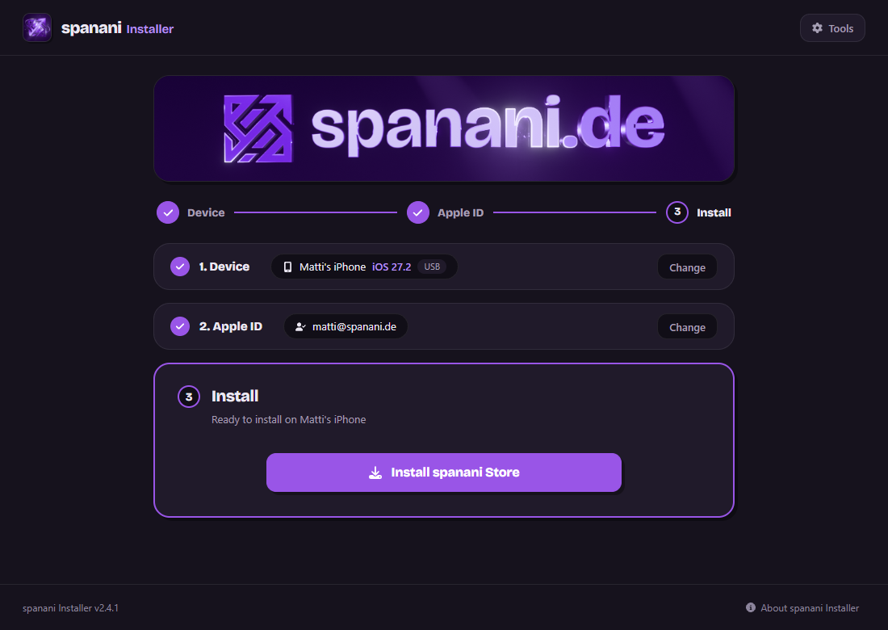
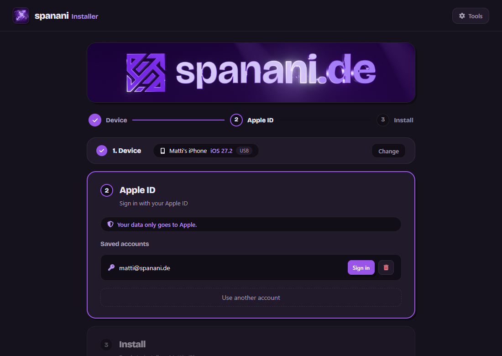
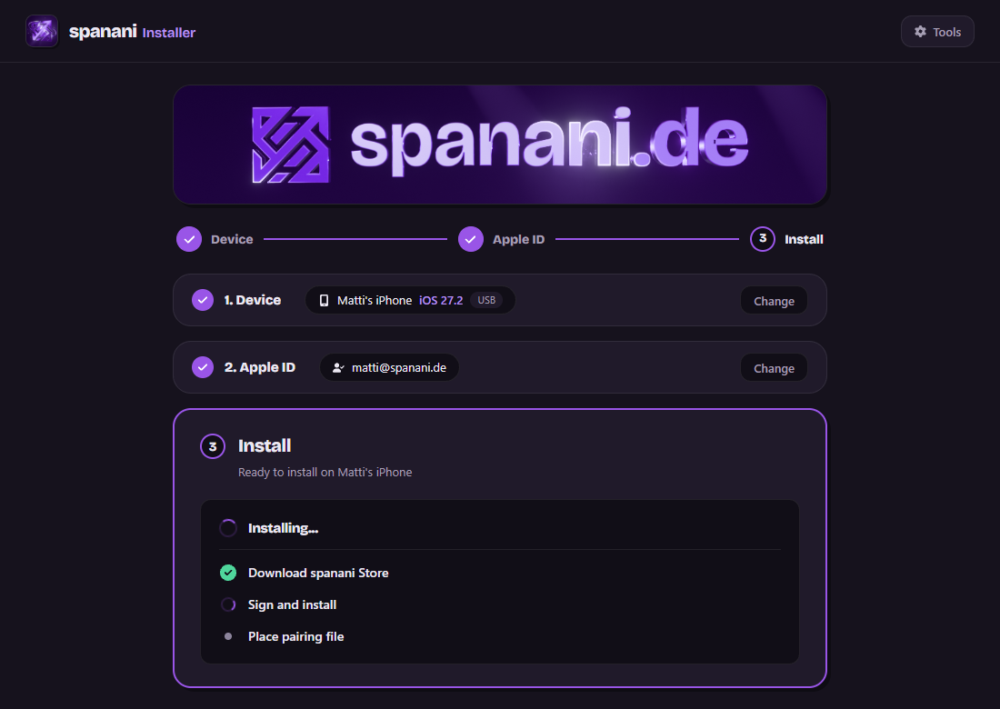
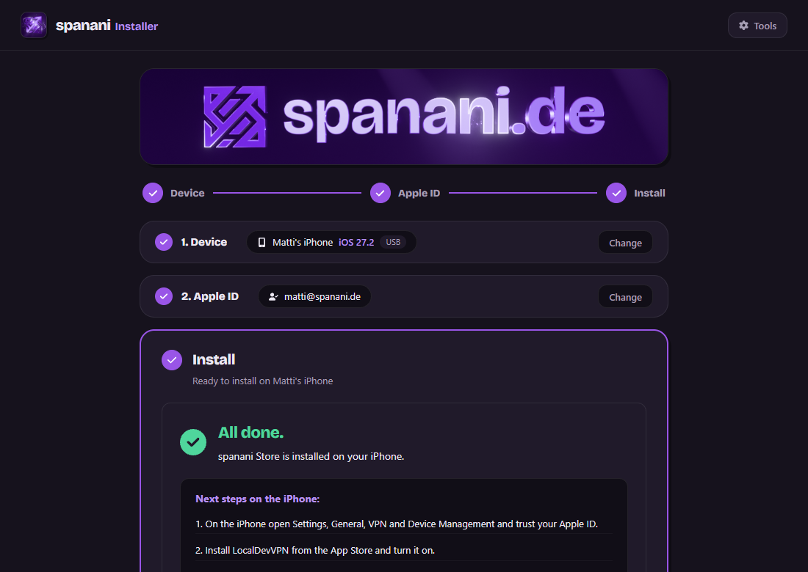

<p align="center">
  <br><br>
  <strong>Put spanani Store on your iPhone in three steps.</strong><br>
  A small Windows desktop app that installs <a href="https://github.com/spananide/spanani-store">spanani Store</a> on your iPhone in three guided steps.<br><br>
  <a href="LICENSE"></a>
  <a href="https://github.com/spananide/spanani-installer/releases"></a>
  
</p>

## How it works

1. **Device**: Connect your iPhone via USB and let the installer detect it.
2. **Apple ID**: Sign in with your free Apple ID.
3. **Install**: The app downloads the latest spanani Store release, signs it with your certificate, installs it, and places the pairing file inside the app with live progress.

|  |  |
| :-: | :-: |
|  |  |

## When you still need a computer

After setup, spanani Store refreshes its apps on the iPhone through LocalDevVPN. You still need a Windows PC with spanani Installer:

- for the first install of spanani Store,
- to pair again when the pairing file stops working, for example after an iOS update or after resetting the iPhone's trust settings,
- to sign and install the store again when it can no longer refresh itself on the iPhone, for example when its 7-day certificate expired or was revoked.

## Features

- **Guided store installation**: Downloads the latest spanani Store release, signs it with your certificate, installs it, and places the pairing file inside the app so the store can talk to the phone.
- **Live progress**: Shows real-time progress for each step.
- **Install any IPA**: Sideload any `.ipa` via the Tools button or by dragging an `.ipa` directly onto the window.
- **Certificate manager**: Manage certificates and revoke old ones when Apple's certificate limit is reached.
- **Pairing file export**: Export pairing files for use in other apps.
- **App ID list**: View registered App IDs.
- **Anisette server**: Pick another anisette server under **Tools > Anisette server**. If sign-in fails with an anisette error such as -80045 or -80046, the error dialog has a button that opens this page.
- **Settings**: Configure language and logs.
- **Secure credentials**: Apple ID passwords are only saved in the Windows Credential Manager (keyring) and only sent to Apple. If the Credential Manager is not available, nothing is saved and you enter the password each time you sign in.

## Download and install

Requirements: Windows 10/11 x64, iTunes from apple.com (not the Microsoft Store) for the Apple device driver, an iPhone with a USB cable, and a free Apple ID.

1. Download the latest `spanani-installer-setup.exe` and `SHA256SUMS.txt` from the [Releases](https://github.com/spananide/spanani-installer/releases) page and [verify the download](#verify-your-download).
2. Run the installer. The .exe is not code-signed yet, so Windows SmartScreen will warn: click **More info** and then **Run anyway**.
3. Connect your iPhone via USB, sign in with your Apple ID, and click **Install**.
4. After the installer finishes, open **Settings > General > VPN & Device Management** on your iPhone and trust your Apple ID.
5. Install **LocalDevVPN** from the App Store and turn it on.
6. Open **spanani Store**.

## Verify your download

Releases after 2.4.1 come with a `SHA256SUMS.txt` file and a build provenance attestation. Version 2.4.1 and older do not have them. The checksum shows that the file was not damaged or swapped after the release was published. The attestation shows that GitHub Actions built the file from this repository.

PowerShell, in the folder with both downloaded files:

```powershell
$expected = (Select-String -Path .\SHA256SUMS.txt -Pattern 'spanani-installer-setup.exe').Line.Split(' ')[0]
$actual = (Get-FileHash .\spanani-installer-setup.exe -Algorithm SHA256).Hash
if ($actual -eq $expected) { "OK: checksum matches" } else { "MISMATCH: do not run this file" }
```

GitHub CLI ([gh](https://cli.github.com/)):

```bash
gh release download --repo spananide/spanani-installer --pattern spanani-installer-setup.exe --pattern SHA256SUMS.txt
gh attestation verify spanani-installer-setup.exe --repo spananide/spanani-installer
```

The .exe is not code-signed yet, so Windows SmartScreen warns even when both checks pass.

## FAQ

<details>
<summary>Windows SmartScreen warning?</summary>
The setup .exe is not code-signed yet, so SmartScreen will warn. Verify the checksum and attestation first (see above), then click "More info" and "Run anyway".
</details>

<details>
<summary>Why do I need iTunes?</summary>
iTunes from apple.com provides the Apple device driver required for Windows to communicate with your iPhone. The Microsoft Store version does not include this driver.
</details>

<details>
<summary>Certificate limit reached?</summary>
When Apple reports "maximum number of certificates", a dialog asks which old certificate to revoke, then continues.
</details>

<details>
<summary>Sign-in fails with -80045 or -80046?</summary>
Apple rejected the anisette data. Open <b>Tools > Anisette server</b> (or use the button in the error dialog), choose another server, reset the anisette state and sign in again.
</details>

<details>
<summary>Is it safe?</summary>
spanani Installer is open source. Your Apple ID password is only saved in the Windows Credential Manager (keyring) and only sent to Apple. It is never written to a file. Anisette data comes from the remote anisette server chosen under Tools > Anisette server.
</details>

## Build from source

Requirements: Bun, Rust (stable), and MSVC build tools.

```bash
bun i
bunx tauri build
```

For UI development without a device:
```bash
VITE_MOCK=1 npx vite --port 1420
```
Open `http://localhost:1420/?state=ready` (other states: `apple`, `installing`, `done`, `error`, `tools`).

CI: The `Build` workflow produces the Windows installer artifact. When a release is published, it also attaches `spanani-installer-setup.exe`, `SHA256SUMS.txt` and a build provenance attestation to that release.

## Credits and licence

spanani Installer is a fork of [iloader](https://github.com/nab138/iloader) by [nab138](https://github.com/nab138) (MIT) with its own interface and a one-click flow for [spanani Store](https://github.com/spananide/spanani-store).

- Fork of [iloader](https://github.com/nab138/iloader) by [nab138](https://github.com/nab138) (MIT)
- Uses the `isideload` and `idevice` crates
- Font: Bricolage Grotesque (SIL OFL)
- Built with Tauri v2, React, and Rust

Licence: MIT (see [LICENSE](LICENSE)). Upstream branding terms are in [LICENSE-BRANDING](LICENSE-BRANDING).

## Disclaimer

Not affiliated with Apple or FMHY. Sideloading uses your own Apple ID at your own risk.
